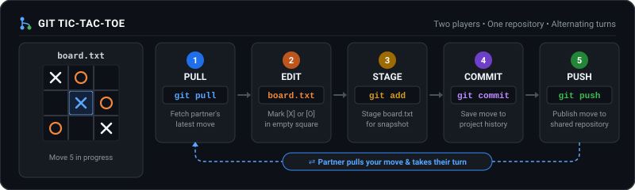

# Git Tic-Tac-Toe Template

A paired collaboration game. You and your partner play tic-tac-toe by editing, reviewing, committing, and sharing moves in a GitHub repository.

## Choose the shared pair repository

1. At the session, choose one participant's prepared public repository created from this template.
2. Its owner invites the other partner as a collaborator.
3. Each partner opens that same pair repository in a separate GitHub Codespace. Both people use the browser-based VS Code editor.

The repository's `main` branch is the clean starting point. It contains `BOARD.txt`, initialized with an empty 3×3 board made only of dots. Each row has three cells separated by one space. Do not play on or change `main`; play each match on its own branch.

## Start a match from `main`

Create a new branch for every match, using the next two-digit number: `match-01`, `match-02`, and so on. Always create the branch from the clean `main` branch so each match begins with the initialized board.

In VS Code, use the branch name in the lower-left status bar to select `main`, then choose **Create new branch**. Enter the next match name, such as `match-01`, and choose `main` as its starting point if prompted. Confirm that the status bar shows the match branch before editing. The first player publishes the branch using **Source Control → Publish Branch**. If the partner's Codespace was already open, first select **Source Control → Fetch** to refresh its branch list; then select `origin/match-01` (or the current match number), check it out, and pull before taking a turn.

For another match, select `main` again and create the next numbered branch from it. Do not create a rematch from a previous match branch, merge match branches into `main`, or reset the board by hand.

## Play and share a move

Both partners work on the same match branch in their own Codespaces. Take turns, and pull your partner's latest change before editing.

1. In **Source Control**, select **Pull**.
2. Open `BOARD.txt`. Change one empty square to your mark (`X` or `O`), then save.
3. Review the board's diff. Check that it contains only the legal move you intended.
4. Stage `BOARD.txt` with the **+** control.
5. Enter a clear commit message and select **Commit**.
6. Select **Push** in Source Control. Tell your partner the move is ready.
7. Your partner pulls, checks the board and commit, and takes the next turn.

Saving, staging, committing, and pushing are separate actions. Both partners should take turns editing and reviewing changes.

## Rehearse before the workshop

For the advance setup check, create your own public repository from this template, open that new repository in your Codespace, select **Ask** in Copilot Chat, and ask exactly: “What does this repository do?” Readiness passes when the response correctly describes this shared tic-tac-toe repository and explains that moves are recorded in `BOARD.txt`. No board edit is required. Keep the repository and Codespace for the workshop. At the session, your pair chooses one prepared repository, invites the partner, and opens it in each person's separate Codespace.

## If you need help

Ask your partner or facilitator to look at the board and Source Control with you.
